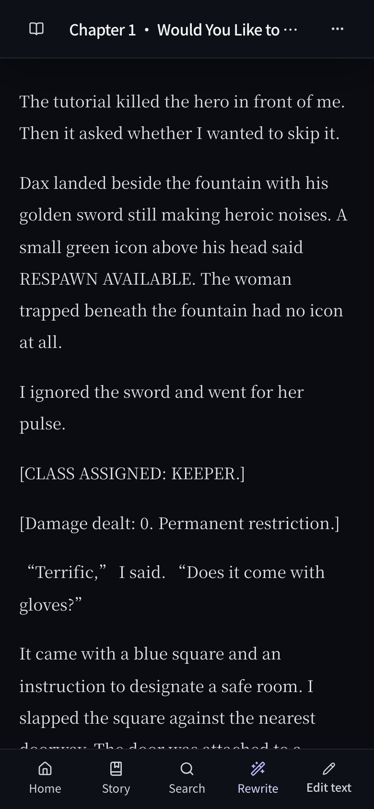
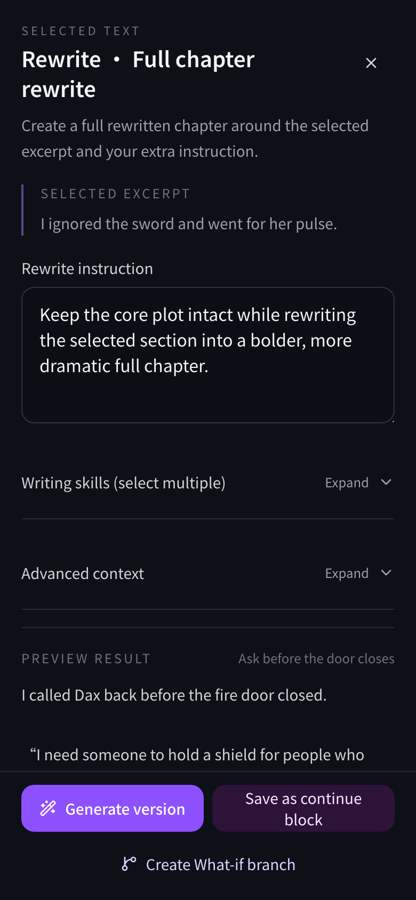
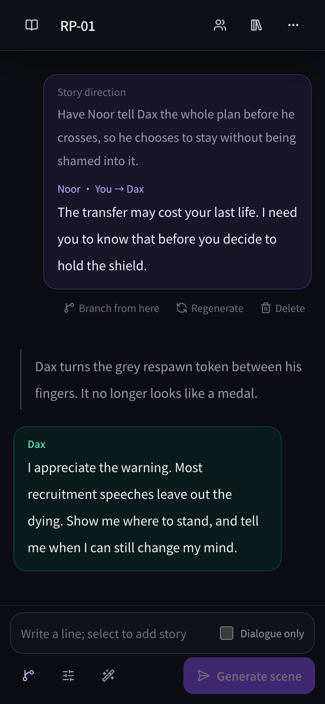
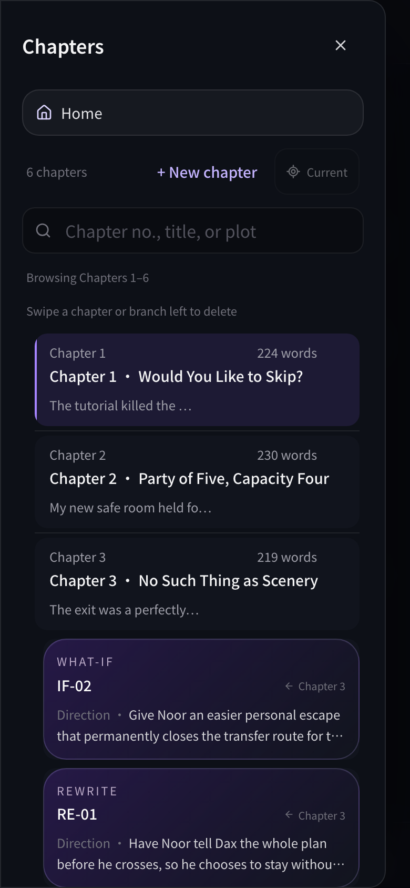
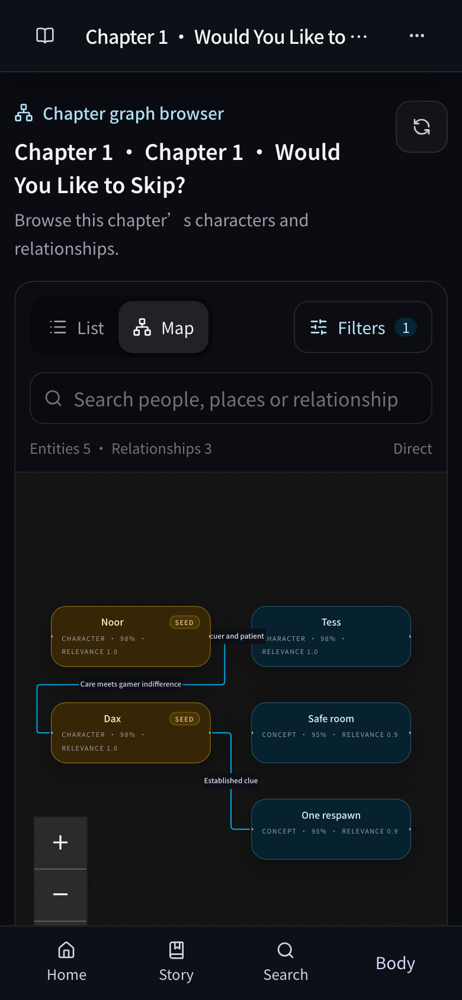
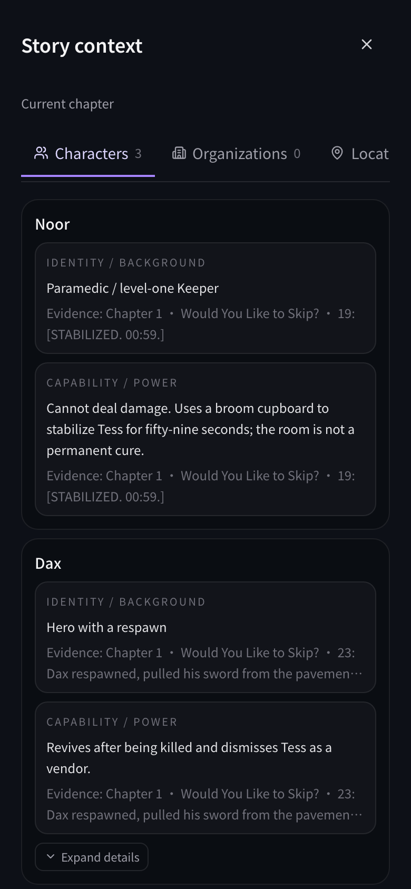

[简体中文](README.md) · **English**

<div align="center">

# ReTale

**Read a novel. Change the moment you wish had gone differently.**

Highlight a passage, describe your idea, and let the story take another path.

[**Try the demo →**](https://ainitan.com) &nbsp;·&nbsp; [Get started](#get-started) &nbsp;·&nbsp; [Common questions](#common-questions)

&nbsp;
&nbsp;


<sub>Screenshots from the <a href="https://ainitan.com">demo site</a>: original sample books, simulated AI results.</sub>

</div>

> [!IMPORTANT]
> **Open source, self-hosted, bring your own key (BYOK).** ReTale is not a paid service and has no accounts. It runs on your own computer or server, and your library stays there. AI features use API keys you get yourself, and the provider bills you directly. We recommend **[DeepSeek](https://platform.deepseek.com/)**: it is inexpensive, fast, and strong at Chinese fiction.

## What you can do

<table>
<tr>
<td width="34%"></td>
<td>

### ✍️ Turn “what if…” into another version

Highlight a passage, tap **Rewrite**, and say what should change:

> “Let Noor call Dax back before the fire door closes.”

ReTale starts from that moment and uses the chapter as context to write a new version of the whole chapter. Keep it as a continuation block or a **What-if branch**; the original is never overwritten.

### 🌿 Branch, continue, or jump ahead

Rewrites, continuations, and alternate branches live in chapter navigation, so you can return to any version and keep writing. Regenerations keep their history. Curious about a later reunion or ending? **Future Jump** summarizes what happens between your branch and a later chapter, then writes that scene anew.

</td>
</tr>
<tr>
<td width="34%"></td>
<td>

### 🎭 Step into a character’s role

Select a scene and enter **Roleplay**. Choose who you play and whom you talk to, give a line or a direction, and AI answers in character with actions and narration. Continue, regenerate, or branch from any turn. With **Dialogue only**, the other character replies in one or two sentences, like a real conversation.

**Optional voice calls:** speak out loud and hear the character answer in a voice you choose, interrupting whenever you like. This needs your own speech keys; see [Voice calls](#optional-voice-calls).

### 🕸️ Characters, relationships, and world details at a glance

Build the story’s knowledge base and ReTale organizes characters, relationships, places, world details, outlines, and events. Open **Story context** or **Graph** to recall why two people became allies or what a character knows by now.

</td>
</tr>
<tr>
<td width="34%"></td>
<td>

### 🔎 Every detail cites the book

Character and relationship details quote their source and link back to it. Before generating, **Advanced context** lets you review and adjust what the AI receives, so you set the direction and can see what it is based on.

### 📚 Writing-skill cards

In **Writing skills**, pick a book or upload TXT reference material and say what to study, such as dialogue with subtext or a tense chase. ReTale extracts techniques, pitfalls, and example passages you can select while writing.

### 🧭 Find a scene without the exact words

Search exact phrases, or describe a scene in your own words, such as “the first time she leaves him a ferry ticket.” Searching by meaning needs an embedding model.

</td>
</tr>
</table>

**Also:** comfortable on a phone (text first, actions at the bottom, dark / light / soft-green themes) · separate models for writing, story analysis, and retrieval · imports compatible SillyTavern presets and regex rules.

## Under the hood

- **Spoiler-free graph-aware RAG:** local HanLP handles Chinese word segmentation and entity recognition first. An LLM then extracts characters, relationships, events, and world rules into a SQLite knowledge graph. Every fact carries a chapter validity range and source evidence, so writing chapter N only uses what is known by chapter N.
- **Hybrid retrieval:** each book gets a LanceDB index for semantic plus full-text recall over passages, character cards, events, and world details, merged with the graph facts. SQLite is the single source of truth; the index can always be rebuilt from it.
- **Reviewable, cost-aware context:** the selection, earlier chapters, characters, relationships, and evidence are assembled by priority and trimmed to a context budget. You can inspect and toggle each block in **Advanced context** before generating. Stable background comes first and new history is appended last, so provider prefix caches (DeepSeek and others) hit more often and requests cost less.
- **Branching story tree:** rewrites, continuation blocks, What-ifs, Future Jumps, and roleplay sessions are nodes in one tree, and context follows each node’s ancestry. Long histories can be compressed into summaries so you can keep writing.
- **Real-time voice pipeline:** streaming speech recognition (Soniox / Qwen) plus local voice detection in a browser AudioWorklet lets you interrupt just by speaking. Replies are split into sentences and synthesized while they are still being written (Fish Audio), and only sentences that finished playing are saved.
- **Lightweight local stack:** Next.js 16, React, and TypeScript on Node’s built-in SQLite, with a separate database per book. Knowledge building runs in a background worker that can pause and resume. No Neo4j, hosted vector database, or GPU required.

Design details: [Knowledge graph design](docs/knowledge-graph-design.md).

## Get started

### 1. Install and run

Choose one of the options below. Each one serves ReTale at **[http://localhost:14500](http://localhost:14500)**. Every release is published both as a Docker image and as an npm package.

#### Option A: Docker (recommended)

You don't need Node.js or Python: the image already includes story analysis (HanLP). It runs on amd64 and arm64.

```bash
docker run -d --name retale --restart unless-stopped \
  -p 14500:14500 \
  -v retale-data:/app/data \
  nitansde/retale:latest
```

> [!WARNING]
> **Always mount a volume at `/app/data`.** That folder holds your whole library: `control.db` plus every book's `novel.db` and search index. Without a volume (the `-v` line above), everything is lost when the container is removed, recreated, or upgraded.

- **Use a folder you choose instead** (easier to find and back up): replace the `-v` line with `-v /path/to/retale-data:/app/data`. The container runs as user `node` (UID 1000). On Linux, make the folder writable first with `sudo mkdir -p /path/to/retale-data && sudo chown 1000:1000 /path/to/retale-data`.
- **Only this computer:** `-p 14500:14500` also opens ReTale to your network. Use `-p 127.0.0.1:14500:14500` to keep it local.
- **Upgrade:** pull the new image, remove the old container, then run the same `docker run` command with the **same `-v` mapping**. Your library stays in the volume:

  ```bash
  docker pull nitansde/retale:latest
  docker rm -f retale
  ```

- **Back up:** stop the container (`docker stop retale`), then copy the folder or volume mounted at `/app/data`.

#### Option B: npm

You need [Node.js](https://nodejs.org/) **22.15.0+** and [Python 3](https://www.python.org/downloads/) (3.11–3.13 recommended). On first start, ReTale uses Python to set up story analysis (HanLP); this needs an internet connection and may take a while. Without Python, ReTale still starts, but building the knowledge base is unavailable.

```bash
npx retale
```

Or install the `retale` command with `npm install -g retale`, then run `retale`.

- Your library is stored in `~/.retale/data`. Set `RETALE_DATA_DIR` to put it somewhere else, for example `RETALE_DATA_DIR=/path/to/retale-data npx retale`.
- By default only this computer can open it. Use `npx retale --hostname 0.0.0.0` to reach it from your phone, and `--port 8080` to change the port.
- Upgrade with `npx retale@latest`, or `npm install -g retale@latest`. The library in `~/.retale/data` is kept.

#### Option C: from source

Install [Node.js](https://nodejs.org/) **22.15.0+** and [Python 3](https://www.python.org/downloads/) for story analysis (3.11–3.13 recommended), download this project, and run in its folder:

```bash
npm install
npm run dev:prod
```

The first install prepares the Python environment for story analysis; it needs an internet connection and may take a while. Then open **[http://localhost:14500](http://localhost:14500)** and keep the terminal running. The library is stored in the project's `data/` folder.

### 2. Add your own AI key

Open **Settings → AI models** and configure the **Writing AI model** and **Knowledge-building AI model**. Any OpenAI-compatible service works, as does local Ollama.

With DeepSeek, as recommended: top up and create an API key on the [DeepSeek platform](https://platform.deepseek.com/), enter `https://api.deepseek.com` as the address, paste the key, and pick a model. Both models can share one key.

### 3. Start adapting

1. Select **Import novel** in the library and choose a TXT file. Automatic chapter splitting currently focuses on Chinese headings such as `第一章` or `第 12 章`.
2. Open a chapter, press and hold to select text, tap **Rewrite**, describe your idea, and generate.
3. Keep a result as a continuation block or What-if branch, then continue from chapter navigation.
4. Build the knowledge base from **More options → Knowledge status** so characters, relationships, and world details inform the writing.

You can start before the whole book is analyzed; more complete references give the AI more to work with.

**On your phone:** on the same trusted network, open `http://YOUR-COMPUTER-LAN-IP:14500`. ReTale is a single-user app without login protection; do not expose it directly to the internet.

### Optional: voice calls

In Roleplay, switch to **Voice chat** to talk out loud. You need two more kinds of keys, entered in **Voice settings**:

| Purpose | Provider | What to enter |
| --- | --- | --- |
| Speech recognition (hearing you) | [Soniox](https://soniox.com/) or [Alibaba Cloud Model Studio, Qwen realtime ASR](https://bailian.console.aliyun.com/) | API key |
| Speech synthesis (the character’s voice) | [Fish Audio](https://fish.audio/) | API key and voice ID (`reference_id`) |

Replies use the writing model and branch history above. Bracketed actions and narration outside quotes are shown but not spoken. Speech providers bill by their own rules; no local GPU is needed.

<details>
<summary>Notes on phone microphones, deployment, and keys</summary>

- **Phones need HTTPS:** browsers block the microphone on plain LAN HTTP (local `localhost` usually works). Put a trusted HTTPS reverse proxy or Tailscale HTTPS in front of port 14500, with response buffering off for streaming.
- **Single instance:** voice sessions rely on a long-running Node process and do not work on serverless instances that are discarded per request.
- **Qwen region:** the endpoint must match your API key’s region; new accounts can enter the official address that includes a Workspace ID.
- **Key storage:** voice keys stay on the server and the UI only shows whether each is set. `.env` can provide initial values via `SONIOX_API_KEY`, `DASHSCOPE_API_KEY`, `FISH_API_KEY`, and `FISH_VOICE_ID`.
- Headphones help keep speaker echo from being heard as an interruption. An interrupted reply saves only the sentences that finished playing.

</details>

For detailed configuration, production deployment, backups, and development commands, see [Development and operations](docs/development.md).

## Common questions

**Does ReTale cost anything?** No. ReTale is open-source, self-hosted software with no paid tier, subscription, or accounts. The only cost is the AI provider you choose, billed to your own API key; local Ollama models only use your hardware.

**Why DeepSeek?** It is inexpensive, fast, good at Chinese fiction, and OpenAI-compatible, so an address and a key are all it takes. Any other OpenAI-compatible service works too.

**How is the demo different from my own install?** The [demo site](https://ainitan.com) only shows the features: the books are preloaded samples and AI results are simulated, with no real model behind them. To use your own novels with real AI, self-host as described in [Get started](#get-started).

**Can I use it without AI?** Yes: import, read, edit by hand, and search exact phrases. Rewriting, roleplay, story analysis, and writing skills need AI; searching by meaning needs an embedding model; voice calls need speech keys.

**Where are my books and keys stored?** On the device running ReTale: in the volume mounted at `/app/data` (Docker), in `~/.retale/data` (npm), or in the project's `data/` folder (source). Your phone only accesses that library. With an online AI service, the text a request needs is sent to the provider you chose. See the [backup instructions](docs/development.md#backups).

**Does it support English?** The interface supports Chinese and English. TXT chapter detection and the built-in story analysis currently favor Chinese novels.

**Can I use SillyTavern presets?** ReTale imports compatible presets and regex rules, but not every field takes effect. See [Preset compatibility](docs/preset-compatibility.md).

---

<div align="center">

[简体中文](README.md) · [Development and operations](docs/development.md) · [Knowledge graph design](docs/knowledge-graph-design.md) · [About the screenshots](docs/readme-media.md)

</div>
