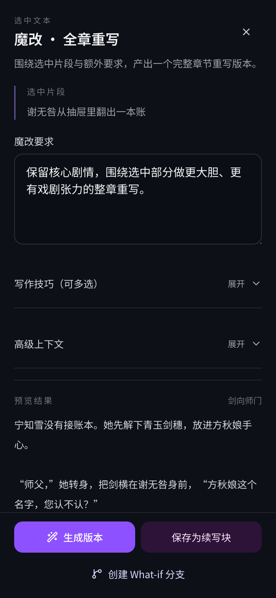
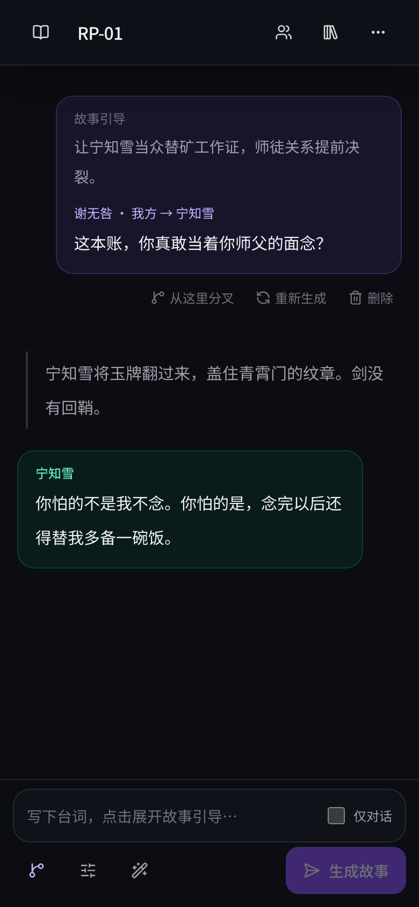
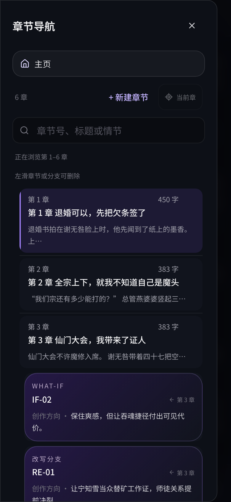
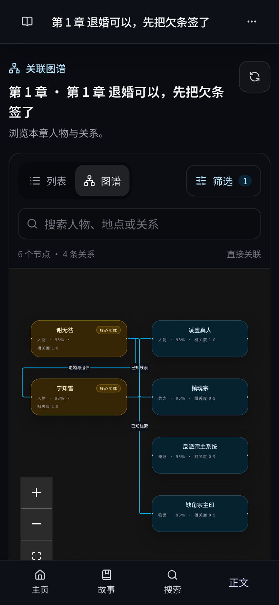
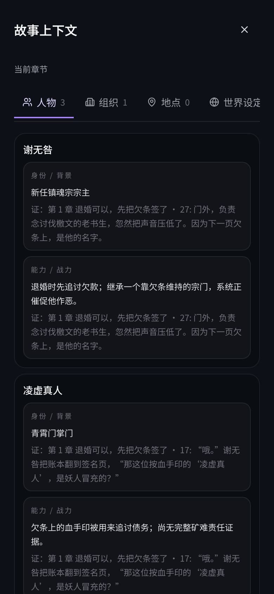

**简体中文** · [English](README.en.md)

<div align="center">

# ReTale · 戏说

**戏说不是胡说，改编不是乱编**

读到想改的情节，选中一段，说出你的想法，让故事换一种走法。

[**在线体验 Demo →**](https://ainitan.com) &nbsp;·&nbsp; [快速开始](#快速开始) &nbsp;·&nbsp; [常见问题](#常见问题)

&nbsp;
&nbsp;


<sub>截图来自 <a href="https://ainitan.com">Demo 站</a>：示例书籍为原创短篇，AI 结果为模拟内容。</sub>

</div>

> [!IMPORTANT]
> **开源、自行部署、自带密钥（BYOK）。** ReTale 不是付费服务，也不需要注册账号：它运行在你自己的电脑或服务器上，书库只存在那里。AI 功能使用你自己申请的 API Key，费用由你直接与 AI 服务商结算。推荐 **[DeepSeek](https://platform.deepseek.com/)**：便宜、速度快，中文写作效果好。

## 能做什么

<table>
<tr>
<td width="34%"></td>
<td>

### ✍️ 魔改：把“如果当时……”写成另一个版本

选中让你在意的片段，点「魔改」，用日常语言说想改什么：

> “让宁知雪当众替矿工作证，师徒关系提前决裂。”

ReTale 以这段情节为切入点，结合章节上下文生成整章新版本。满意就「保存为续写块」或「创建 What-if 分支」；原文不会被覆盖。

### 🌿 分支、续写，或直接跳到未来

改写、续写和假设分支都挂在章节导航里，随时回到任何一个版本接着写，重新生成也有历史可查。想看后面的重逢或结局，用「跳到未来」选一个目标章节，ReTale 会先梳理中间发生了什么，再写出那一刻的新版本。

</td>
</tr>
<tr>
<td width="34%"></td>
<td>

### 🎭 走进故事，和角色对话

选中一个场景进入「角色扮演」，选你扮演的人物和互动对象，给一句台词或一个剧情方向，AI 接着写对方的回应与动作。可以继续、重新生成，也能从任意一轮分叉。勾选「仅对话」时，对方每次只回一两句，像真的在聊天。

**可选语音通话：** 直接开口说话，角色用你选的音色实时回答，可随时打断。需要自备语音识别和语音合成的密钥，见[语音通话](#可选语音通话)。

### 🕸️ 人物、关系、设定，一查就有

构建故事知识库后，ReTale 会整理人物、关系、地点、世界设定、大纲和事件。忘了“他们为什么结盟”，或拿不准“这个角色此时知道什么”，打开「故事上下文」或「图谱」就能看到。

</td>
</tr>
<tr>
<td width="34%"></td>
<td>

### 🔎 每条设定都有原文依据

人物与关系详情会附上引用的原文，并能跳回出处。生成前还可以在「高级上下文」里检查、调整这次提供给 AI 的参考内容：改编方向由你决定，依据也看得见。

### 📚 写作技巧卡

在「写作技巧」里选一本书或上传 TXT 素材，说出想学什么，比如“有潜台词的对话”“紧张的追逐场面”。ReTale 会提炼写法、避免事项和参考范文，创作时可以随手选用。

### 🧭 忘了原句，也能找回情节

记得原话就精确搜索；只记得情节，就用一句描述按含义查找，例如“她第一次把船票留给他”。按含义搜索需要另配 Embedding 检索模型。

</td>
</tr>
</table>

**还有：** 手机上读写都舒服（正文优先，常用操作在底部，深色 / 浅色 / 护眼绿主题）· 写作、故事分析、检索可以分别选用不同模型 · 可导入兼容的 SillyTavern 预设和正则。

## 快速开始

### 1. 安装并启动

准备 [Node.js](https://nodejs.org/) **22.15.0+** 和 [Python 3](https://www.python.org/downloads/)（故事分析会用到，建议 3.11–3.13），下载本项目，在项目文件夹中运行：

```bash
npm install
npm run dev:prod
```

首次安装会自动准备故事分析用的 Python 环境，需要联网，可能要等一会儿。启动后在浏览器打开 **[http://localhost:14500](http://localhost:14500)**，保持终端运行。

### 2. 填入你自己的 AI 密钥

打开「设置 → AI 模型」，配置「写作 AI 模型」和「知识库构建 AI 模型」。任何兼容 OpenAI 接口的服务都可以，也可以连接本地 Ollama。

以推荐的 DeepSeek 为例：在 [DeepSeek 开放平台](https://platform.deepseek.com/) 充值并创建 API Key，接口地址填 `https://api.deepseek.com`，粘贴 API Key，再选择模型。两个模型可以用同一个 Key。

### 3. 开始改编

1. 在书库点「导入小说」，选择 TXT 文件。自动分章目前主要识别「第一章」「第 12 章」这类中文标题。
2. 打开章节，长按选中文字，点底部「魔改」，写下想法并生成版本。
3. 把喜欢的结果保存为续写块或 What-if 分支，之后从章节导航继续。
4. 在「更多选项 → 知识状态」构建知识库，让人物、关系和设定参与创作。

不必等全书分析完才开始；资料越完整，AI 可参考的内容越充分。

**用手机访问：** 手机和电脑在同一可信网络时，打开 `http://电脑的局域网IP:14500` 即可。ReTale 是单用户应用，没有登录保护，不要直接暴露到公网。

### 可选：语音通话

角色扮演里可以切换到「语音聊天」直接说话。需要再准备两类密钥，在「语音设置」中填写：

| 用途 | 服务商 | 需要填写 |
| --- | --- | --- |
| 语音识别（听你说话） | [Soniox](https://soniox.com/) 或 [阿里云百炼 Qwen 实时识别](https://bailian.console.aliyun.com/) | API Key |
| 语音合成（角色开口） | [Fish Audio](https://fish.audio/) | API Key 和音色 ID（`reference_id`） |

角色回复沿用上面的写作模型和分支历史，括号里的动作、引号外的旁白只显示不朗读。语音服务按各自规则计费，不需要本地 GPU。

<details>
<summary>手机麦克风、部署和密钥的注意事项</summary>

- **手机需要 HTTPS：** 普通局域网 HTTP 地址无法使用麦克风（本机 `localhost` 通常可以）。可以在 14500 端口外加一层可信的 HTTPS 反向代理或 Tailscale HTTPS，代理需关闭流式响应缓冲。
- **单实例部署：** 语音会话依赖常驻 Node 进程，不适用于随请求销毁的 serverless 实例。
- **Qwen 地域：** 连接地址要与 API Key 所属地域一致；新账号可在设置中填写包含 Workspace ID 的官方地址。
- **密钥保存：** 语音密钥保存在服务端，界面只显示是否已配置；也可以用 `.env` 中的 `SONIOX_API_KEY`、`DASHSCOPE_API_KEY`、`FISH_API_KEY`、`FISH_VOICE_ID` 提供初始值。
- 建议戴耳机，减少扬声器回声被误识别为打断。被打断的回复只保存已完整播完的句子。

</details>

详细配置、正式部署、备份和开发命令见[安装与维护参考（英文）](docs/development.md)。

## 常见问题

**ReTale 收费吗？** 不收费。ReTale 是开源的自托管软件，没有付费版、订阅或账号体系。唯一的花费来自你选用的 AI 服务商，按你自己的 API Key 计费；用本地 Ollama 模型则只消耗自己的设备性能。

**为什么推荐 DeepSeek？** 价格低、速度快、中文写作效果好，并且兼容 OpenAI 接口，填写地址和 Key 就能用。也可以换成任何其他兼容 OpenAI 接口的服务。

**Demo 站和自己部署有什么区别？** [Demo 站](https://ainitan.com)只用来展示功能，书是预置的示例，AI 结果是模拟内容，不会调用真实模型。想用自己的小说和真实 AI，需要按[快速开始](#快速开始)自行部署。

**不接 AI 能用吗？** 可以导入、阅读、手动编辑和精确搜索。魔改、角色扮演、故事分析和技巧提炼需要 AI；按含义搜索另需 Embedding 模型；语音通话另需语音服务的密钥。

**我的书和密钥存在哪里？** 都在运行 ReTale 的设备上，默认是 `data/` 文件夹。手机只是访问这份书库。使用在线 AI 时，本次请求需要的文本会发给你选择的服务商。备份方式见[备份说明](docs/development.md#backups)。

**支持英文吗？** 界面可切换中英文。TXT 自动分章和内置故事分析目前更偏向中文小说。

**已有 SillyTavern 预设可以用吗？** 可以导入兼容的预设和正则，但并非所有字段都会生效，详见[预设兼容说明](docs/preset-compatibility.md)。

---

<div align="center">

[English](README.en.md) · [安装与维护](docs/development.md) · [故事知识库设计](docs/knowledge-graph-design.md) · [截图说明](docs/readme-media.md)

</div>
